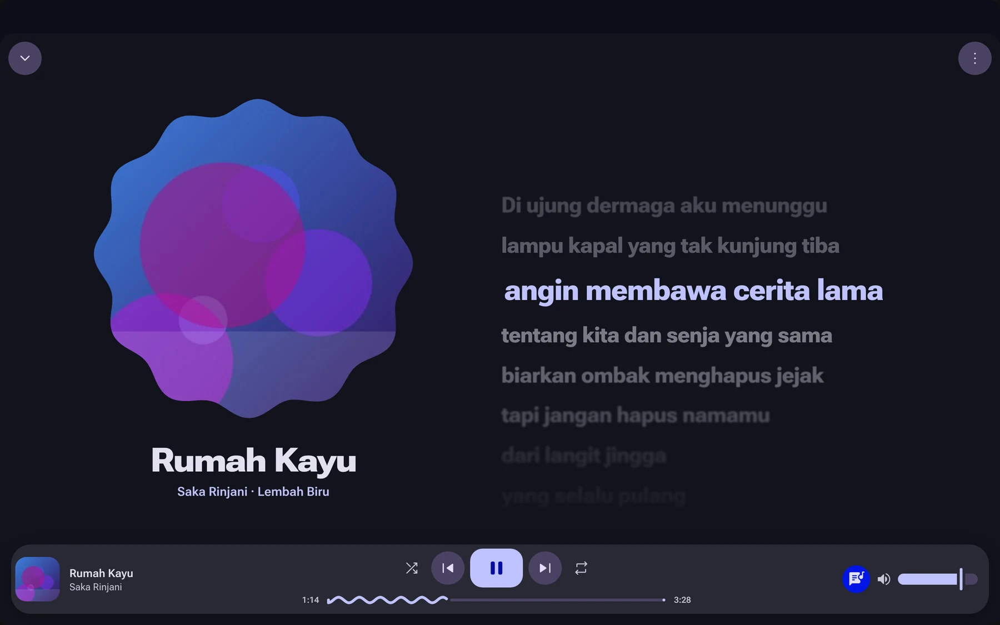
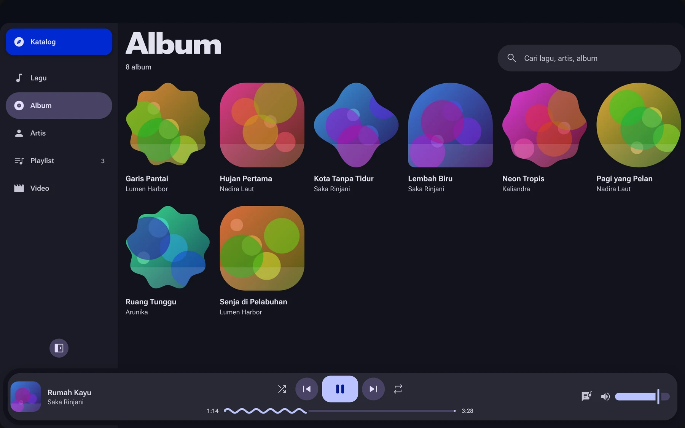
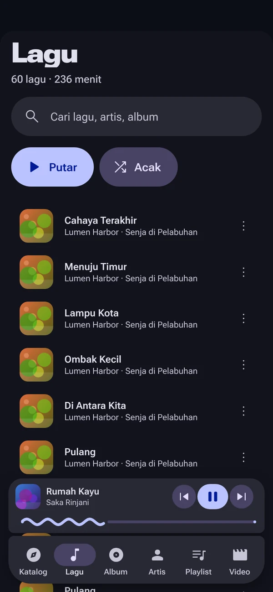
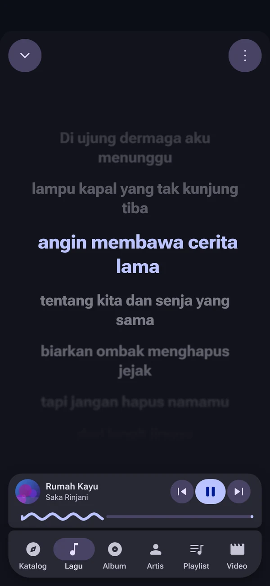

<div align="center">


# Neptunus

**One small, beautiful player for your music and your videos, on every device.**

Local files, your own S3 bucket and streaming extensions, wrapped in a Material 3 Expressive UI that takes its colours from what's playing.

[](https://github.com/okuru-id/neptunus/releases)
[](https://github.com/okuru-id/neptunus/releases)
[](LICENSE)


[**Download**](https://github.com/okuru-id/neptunus/releases) · [Website](https://neptunus.id) · [Features](#features) · [Build from source](#build-from-source)

<br />



  

<sub>Songs, artists and covers in these screenshots are made up.</sub>

</div>

---

## Why Neptunus

- **Music and video in one app.** No separate player for your films.
- **Tiny.** It uses the system webview instead of shipping a browser, and decodes audio natively in Rust.
- **Your files stay yours.** Play from a folder or your own S3-compatible bucket. No account, no tracking.
- **Runs everywhere.** Linux, Windows, macOS, Android and iOS from one codebase.
- **Extensible.** Plug in catalog, download, lyrics, video and subtitle extensions.

## Features

### 🎵 Music

| | |
|---|---|
| **Library** | Scan folders; tags and cover art are read with lofty and kept in SQLite. Browse by song, album, artist or playlist, with search. |
| **Playback** | Gapless queue, shuffle, repeat, equalizer. Native decoding of MP3, FLAC, AAC/M4A, OGG, Opus and WAV (rodio + symphonia). |
| **Synced lyrics** | From a sidecar `.lrc`, the embedded tag or [LRCLIB](https://lrclib.net), cached after the first download. |
| **Cloud** | Stream from any S3-compatible bucket without downloading; tags, covers and `.lrc` are read with range requests. |
| **Extensions** | [Mornye](https://mornye.com)/SpotiFLAC-compatible extensions (`.sflx`) add online catalogs, downloads and lyrics. The Mornye registry is loaded by default; any other repository URL or a package file works too. |
| **System integration** | MPRIS (Linux), SMTC (Windows), Now Playing (macOS, iOS lock screen), Android media notification, system tray. Keeps playing in the background on mobile. |

### 🎬 Video

| | |
|---|---|
| **Local and S3** | MP4, MKV, WebM and MOV from your folders or your bucket. |
| **Stremio addons** | Paste any Stremio addon manifest URL. Catalogs show as scrollable rows (Cinemeta is the default), with a detail page, seasons and episodes, and a source picker that lists every addon's streams side by side. |
| **Player** | YouTube-style controls, buffering indicator, resume where you left off, HLS streams, keyboard shortcuts, and an "Open in VLC" button for anything the system can't decode. |
| **Subtitles** | From Stremio subtitle addons, with a side panel to pick the language, adjust the delay (`g` / `h`), and set size, colour, background and position. |
| **Offline-friendly** | Catalogs, sources and subtitles are cached in SQLite, so pages load instantly and still work when an addon is down. |

### 🎨 Design

The whole interface is recoloured from the current cover art, with expressive clip shapes and spring motion, following Material 3 Expressive. The UI text is currently in Indonesian.

## Download

Grab the latest build from [**Releases**](https://github.com/okuru-id/neptunus/releases):

| Platform | File |
|---|---|
| Linux | `.deb`, `.rpm` or `.AppImage` |
| Windows | `.msi` or `.exe` |
| macOS | `.dmg` |
| Android 8.0+ | `Neptunus_<version>_arm64.apk` |
| iOS | `Neptunus_<version>_unsigned.ipa` (has to be signed, see [iOS](#ios)) |

## Build from source

You need [Rust](https://rustup.rs) (stable), Node.js 20+ and the [Tauri prerequisites](https://tauri.app/start/prerequisites/) for your OS.

```bash
npm install
npm run tauri dev     # run in development mode
npm run tauri build   # build an installer for the current OS
```

Installers land in `src-tauri/target/release/bundle/`.

<details>
<summary><b>Debian / Ubuntu</b></summary>

```bash
sudo apt update
sudo apt install -y build-essential curl wget file pkg-config libssl-dev \
  libwebkit2gtk-4.1-dev libayatana-appindicator3-dev librsvg2-dev libasound2-dev patchelf
npm ci
npm run tauri build
```

To build only the `.deb`, run `npm run tauri build -- --bundles deb`, then install it with `sudo apt install ./Neptunus_*.deb`.

</details>

Pushing a `v*` tag builds installers for all five platforms in CI and attaches them to a draft release. Linux builds are made on Ubuntu 22.04 so they run on older distros too.

### Linux notes

- Runs natively on Wayland. Set `NEPTUNUS_X11=1` to use XWayland instead.
- Video goes through GStreamer and needs `gstreamer1.0-plugins-good`, `gstreamer1.0-plugins-bad` and `gstreamer1.0-libav` (the `.deb` pulls them in).
- The tray icon needs a StatusNotifierItem host; on GNOME that is the AppIndicator extension, which Ubuntu ships by default.

## Mobile

### Android

Open the APK on the phone (allow installs from that source when asked), or from a computer with USB debugging on:

```bash
adb install -r Neptunus_*_arm64.apk
```

Updates install over the previous version: **Unduh & pasang** in the app downloads the new APK and opens the Android installer (the first time, allow Neptunus to install apps). On first launch, allow access to music and videos so the library can read your folders.

### iOS

iOS only runs signed apps, so the IPA has to be signed before installing.

**Install the signed build over the air (registered iPhones).** Copy this into Safari's address bar on the iPhone, open it and tap **Install**. It always installs the latest release:

```
itms-services://?action=download-manifest&url=https://github.com/okuru-id/neptunus/releases/latest/download/manifest.plist
```

Only iPhones whose UDID is in the signing profile can install it (see *Your own Apple Developer account* below); on any other one iOS says it can't install the app. Tapping a downloaded `.ipa` in the Files app does nothing; this link is the way to install that build.

**Free Apple ID (re-sign every 7 days).** Use [SideStore](https://sidestore.io), [iloader](https://github.com/nab138/iloader) or [Sideloader](https://github.com/Dadoum/Sideloader): log in with an Apple ID (a separate one is a good idea), pick the IPA, and it is signed and installed for 7 days. A free Apple ID can keep at most 3 apps signed at a time, SideStore included.

<details>
<summary><b>Keep it from expiring with SideStore</b></summary>

1. Install SideStore with iloader (it also sets up the pairing file SideStore needs), plus the local VPN app SideStore asks for from the App Store (currently LocalDevVPN).
2. Install Neptunus from SideStore (**+**, then pick the IPA).
3. In the Shortcuts app, add an automation (for example daily at 03:00, or when the charger is connected) that runs SideStore's **Refresh All Apps**, set to run immediately.

Each refresh resets the apps to 7 days; *My Apps* shows how many days are left. If SideStore itself expires, install it again from a computer with iloader.

</details>

<details>
<summary><b>Your own Apple Developer account (valid for a year)</b></summary>

This needs a paid [Apple Developer Program](https://developer.apple.com/programs/) membership. On Linux, make the key and certificate with `openssl` and keep them outside the repo.

1. Make a private key and a certificate signing request:

   ```bash
   mkdir -p ~/ios-cert && cd ~/ios-cert
   openssl genrsa -out neptunus.key 2048
   openssl req -new -key neptunus.key -out neptunus.csr -subj "/emailAddress=YOUR_APPLE_ID_EMAIL/CN=Your Name/C=ID"
   ```

2. On [developer.apple.com/account](https://developer.apple.com/account), under **Certificates, Identifiers & Profiles**:
   - **Certificates › + › Apple Development**: upload `neptunus.csr` and download `development.cer`.
   - **Devices › +**: add your iPhone's UDID (`idevice_id -l` prints it).
   - **Identifiers › + › App IDs › App**: the explicit bundle ID `id.neptunus.desktop`.
   - **Profiles › + › iOS App Development**: pick that App ID, the certificate and your device, then download the `.mobileprovision`.

3. Combine the certificate and key into a `.p12` (add `-legacy` if a Mac or Windows tool rejects it):

   ```bash
   openssl x509 -inform DER -in development.cer -out development.pem
   openssl pkcs12 -export -inkey neptunus.key -in development.pem -out neptunus.p12
   ```

4. Sign with [zsign](https://github.com/zhlynn/zsign) (build it from source: `build/linux`, then `make`) and install over USB:

   ```bash
   sudo apt install libimobiledevice-utils ideviceinstaller
   zsign -k ~/ios-cert/neptunus.p12 -p 'P12_PASSWORD' -m ~/ios-cert/Neptunus_Dev.mobileprovision -o Neptunus_signed.ipa Neptunus_*_unsigned.ipa
   ideviceinstaller install Neptunus_signed.ipa
   ```

5. **Updates without a cable.** Add the certificate to the repository's Actions secrets once:

   ```bash
   base64 -w0 ~/ios-cert/neptunus.p12 | gh secret set IOS_P12
   gh secret set IOS_P12_PASSWORD
   base64 -w0 ~/ios-cert/Neptunus_Dev.mobileprovision | gh secret set IOS_PROFILE
   ```

   From then on every release also has a signed `Neptunus_<version>.ipa` and a `manifest.plist`, and **Unduh & pasang** in the app installs the update over the air (iOS asks to confirm, then the app updates on the home screen). Only devices in the profile can install it; after adding a device, download the profile again and update `IOS_PROFILE`.

Unlock the iPhone and tap **Trust** the first time it is connected. The certificate and profile last a year. Back up `neptunus.key` and `neptunus.p12`; losing them means making a new certificate. Only sign with a certificate you own: misusing an enterprise certificate gets it revoked for everyone.

</details>

**Local files on iOS:** apps can only read their own folder. Copy songs and videos with the Files app to *On My iPhone › Neptunus*, then add that folder in Neptunus (Settings › Lokal › Tambah folder).

## Tech stack

| Part | Choice |
|---|---|
| Shell | Tauri 2 |
| UI | Vue 3 (`<script setup>`), TypeScript, Vite |
| Audio | rodio + symphonia |
| Video | System media stack (GStreamer, WebKit, WebView2) + hls.js fallback |
| Tags / cover art | lofty |
| Storage | SQLite (rusqlite) |
| Extensions | QuickJS (rquickjs) sandbox |
| Media controls | souvlaki, MediaSession, MPNowPlayingInfoCenter |
| Cloud | rust-s3 |

## Contributing

Issues and pull requests are welcome. If Neptunus is useful to you, a ⭐ helps other people find it.

## License

[MIT](LICENSE)

## Credits

- [PixelPlayer](https://github.com/PixelPlayerHQ/PixelPlayer) by Theo Vilardo, the Material 3 Expressive music player for Android that inspired the design. If you're on Android, go give it a star.
- [Mornye](https://mornye.com) (formerly [SpotiFLAC](https://spotiflac.com/extension)), whose extension format and [extension registry](https://github.com/mornyeapp/Mornye-Extension) the music extensions follow.
- [LRCLIB](https://lrclib.net) for the free lyrics API.
- [Stremio](https://www.stremio.com) for the open addon protocol.

> **Not affiliated.** Neptunus is an independent, from-scratch project. It shares PixelPlayer's design ideas but contains none of its code or assets, and is not endorsed by its author. Neptunus ships no media and no streaming sources; you choose what to install and play.
